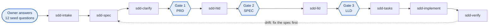

<p align="center">
  
</p>

# SDD Framework

A spec-driven development template for teams that build software with AI coding agents. People write what only people can decide. Agents write everything that can be derived from it. Checks in CI keep every test and every line of behavior linked to an approved requirement.

It works with **Claude Code** today (skills, agent personas, hooks and slash commands) and with **Codex and other agents** through [`AGENTS.md`](AGENTS.md). The tools need only **Node.js 20 or later** and have no dependencies, so they run the same on macOS, Linux, Windows, a dev container or CI.

- [How it works](#how-it-works)
- [Quick start](#quick-start)
- [Working in Claude Code](#working-in-claude-code)
- [What is in the box](#what-is-in-the-box)
- [Documentation](#documentation)

## How it works

**1. Every document has a layer, and every section has an owner.** Each layer derives from the one above. Sections are tagged **H** (human-authored), **C** (co-authored: an agent drafts options, a person decides) or **A** (agent-generated, by a named persona).

<p align="center">
  
</p>

**2. People enter the chain at four points; agents do the rest.** The owner answers the seed questions and approves the problem framing (Gate 0). Eight skills then run in order; at Gates 1 to 3 a hook blocks the next skill until a person approves the document it builds on.



**3. Links are plain text that a script checks.** Every acceptance criterion has a stable ID. The test that exercises it and the code entry point that implements it cite the ID in a comment:

```ts
// @spec IAM-2
it("IAM-2: invalidates cached grants when a role is revoked", () => { /* ... */ });
```

`trace-check` fails the build when a criterion has no test, when a comment cites an ID that does not exist, or when the test plan claims coverage that is not there.

**4. One queue for delivery and support.** New work is ranked P1 to P3; bugs, failures, blockers and drift are ranked S0 to S4. Both feed one queue: **S0 > S1 > P1 > S2 = P2 > S3 = P3 > S4**.

The full model is in the [framework overview](docs/guide/framework-overview.md) and the [standard](docs/standards/spec-driven-development-v1.md).

## Quick start

You need [Node.js 20 or later](https://nodejs.org) and git. Claude Code is optional but recommended ([install guide](https://code.claude.com)).

### Explore the worked example in this repository

```bash
git clone <this repository> sdd_framework && cd sdd_framework
npm run setup          # installs dev dependencies, then runs: node tools/sdd/cli.mjs doctor
npm test               # the sample IAM code and the framework's own tool tests
npm run sdd:check      # spec-lint and trace-check over the example documents
```

The example follows one requirement through every layer: parent requirement `FR-3`, criterion `IAM-2` in the [IAM component PRD](docs/prd/components/PRD-iam-v1.md), [SPEC](docs/spec/SPEC-v1.md) section 4.2, [LLD-iam](docs/lld/LLD-iam-v1.md) §3, milestone task [M1-3](docs/build/M1-plan-v1.md), and finally the [test](test/iam/revoke-role.test.ts) and [code](src/iam/revoke-role.ts) that carry `@spec IAM-2`.

### Start a brand-new repository

```bash
node sdd_framework/tools/sdd/cli.mjs init ../my-app --components iam:IAM,billing:BILL --git
cd ../my-app
node tools/sdd/cli.mjs doctor
claude          # then type: /sdd-new <what you want to build>
```

`init` installs the constitution, skills, personas, hooks, templates, checks and CI into an empty folder. See [new repository](docs/guide/new-repository.md).

### Upgrade a repository that already uses the framework

```bash
node sdd_framework/tools/sdd/cli.mjs upgrade ../my-app            # dry run
node sdd_framework/tools/sdd/cli.mjs upgrade ../my-app --apply    # new files added; changed ones go to .sdd-proposed/
```

See [versioning](docs/guide/versioning.md).

### Add it to an existing, running application

```bash
node sdd_framework/tools/sdd/cli.mjs adopt ../existing-app           # dry run: shows the plan, writes nothing
node sdd_framework/tools/sdd/cli.mjs adopt ../existing-app --apply   # writes new files only
```

`adopt` analyzes the code (languages, frameworks, components, tests, APIs, schemas, CI) and adds the framework **without changing or deleting any existing file**. Where a file already exists, such as your own `AGENTS.md`, it writes the framework's version to `.sdd-proposed/` for you to merge. It never runs your build or tests, and its CI workflow runs in advisory mode so existing pipelines cannot break. It also writes [the list of information still needed from people](docs/guide/existing-repository.md#what-adopt-asks-for) before the framework can run. See [existing repository](docs/guide/existing-repository.md).

## Working in Claude Code

| Type in Claude Code | What happens | Human step |
| --- | --- | --- |
| `/sdd-new <idea>` | Interviews you with the twelve seed questions, then drafts the PRD | Answer the questions |
| `/sdd-clarify` | Finds gaps, conflicts and ambiguous criteria | Gate 1: approve the PRD |
| `/sdd-hld` | Drafts the SPEC and ADR options with tradeoffs | Gate 2: choose, approve |
| `/sdd-lld` | Writes one LLD per component, contracts and the test plan | Gate 3: review contracts, schema, authZ |
| `/sdd-tasks`, `/sdd-implement` | Plans slices, then builds tests first with `@spec` | Code review |
| `/sdd-verify` | Runs the checks, updates the trace index, reports drift | |
| `/sdd-adopt` | Walks you through adopting an existing codebase | Answer the missing items |
| `/sdd-triage` | Classifies a bug, failure or blocker and ranks it S0 to S4 | Confirm S0 and S1 |
| `/sdd-check`, `/sdd-status` | Runs the checks; shows where each component stands | |

A person approves a document by setting `status: approved` in its front matter. Approved versions are frozen; the next change goes into `-v2`. Details are in the [usage guide](docs/guide/usage.md).

## What is in the box

```text
AGENTS.md                 constitution: rules, commands, definition of done (CLAUDE.md points here)
sdd.config.json           components, ID prefixes, paths and feature flags
docs/                     what people review: vision, PRDs, ADRs, SPEC, LLDs, contracts, test plan, plans, runbooks
  templates/              one template per artifact; every section tagged H, C or A with its persona
  standards/              the framework standard and the agent persona standard
  guide/                  setup, usage, new and existing repositories, tools, other agents, versioning, catalog
.claude/
  skills/                 ten skills: the eight-step chain plus sdd-adopt and sdd-triage
  agents/                 eleven personas, from analyst to verifier
  commands/               /sdd-new, /sdd-check, /sdd-status
  settings.json           gate and protect-approved hooks
.claude-plugin/           packages the skills, personas and hooks as a Claude Code plugin
tools/
  sdd/                    command line: init, adopt, upgrade, doctor, check, new, docmap, catalog
  spec-lint/              document checks
  trace-check/            requirement, test and code link checks
  hooks/                  Claude Code hooks
src/, test/               the worked example (TypeScript and Vitest)
.devcontainer/            a ready-made local environment
```

Every skill, persona and command carries a semantic version and a changelog table. The [catalog](docs/guide/catalog.md) lists them all and CI checks that it is current.

## Documentation

| Guide | For |
| --- | --- |
| [Framework overview](docs/guide/framework-overview.md) | What the framework is and why it is shaped this way |
| [Setup](docs/guide/setup.md) | Preparing a local environment on any machine |
| [New repository](docs/guide/new-repository.md) | Starting a project with the framework |
| [Existing repository](docs/guide/existing-repository.md) | Adopting it in a running application, safely |
| [Usage](docs/guide/usage.md) | The day-to-day workflow, gates and versions |
| [Tools](docs/guide/tools.md) | Command line, checks, hooks, plugin |
| [Other agents](docs/guide/other-agents.md) | Using the framework with Codex and future agents |
| [Versioning](docs/guide/versioning.md) | How the framework, skills and personas are versioned and upgraded |
| [Catalog](docs/guide/catalog.md) | Every skill, persona and command with its version |
| [Doc map](docs/README.md) | The documents of the worked example, layer by layer |

## Install as a Claude Code plugin

The skills, personas and hooks can also be installed into Claude Code as a plugin from this repository:

```text
/plugin marketplace add <owner>/<repository>
/plugin install sdd-framework@sdd-framework
```

The plugin brings the skills and personas; a repository still needs `sdd.config.json`, `AGENTS.md` and `docs/` from `init` or `adopt`. Avoid using the plugin inside a repository that already has the same skills in `.claude/`, or they load twice.

## Requirements and license

Node.js 20 or later. git is optional (it enables the staleness and reach checks). No license has been chosen for this template yet; add one before you share it.
