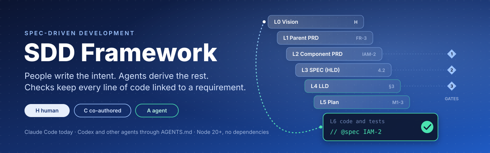
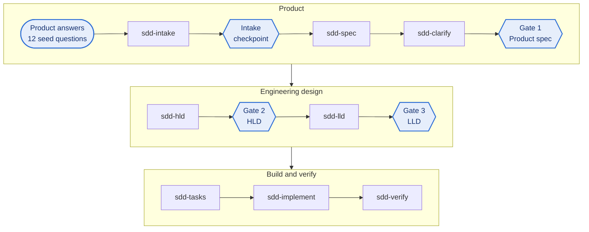

<p align="center">
  
</p>

# SDD Framework

SDD creates a controlled bridge from Product intent to Engineering delivery. Product owns the problem, outcomes, scope, priorities, constraints and acceptance. Engineering contributes feasibility and risk input while intent is formed, then owns architecture and implementation choices. Shared templates, named decision owners, approval gates and stable identifiers keep that connection from requirements through tests, code and evidence.

This repository is a **reusable toolkit**. Any team can install its portable core: the templates, decision ownership, gates, identifiers, trace checks and change control. Each team adapts the local choices (approvers, tools, paths, roles and workflow) to its own governance. The toolkit ships with a **Tech domain reference profile**: the Tech domain is the example L1 domain where the toolkit is being piloted and iterated. The worked example is synthetic and does not select the pilot's capability or application.

This is a reference implementation, not a finished enterprise standard. Agents support the workflow by preparing bounded, traceable material from approved inputs. They do not replace accountable Product, Engineering, Security or business decisions.

- [Start by audience](#start-by-audience)
- [How it works](#how-it-works)
- [Quick start](#quick-start)
- [Working in Claude Code](#working-in-claude-code)
- [What is in the box](#what-is-in-the-box)
- [Documentation](#documentation)

## Start by audience

| You are | Read |
| --- | --- |
| **An executive** | This page, then the [framework overview](docs/guide/framework-overview.md): the value, the scope hierarchy, the risks and the [open decisions](docs/standards/spec-driven-development-v3.md#18-open-decisions) |
| **A Product Manager** | The [usage guide](docs/guide/usage.md) from intake to Gate 1, the [seed questions](docs/standards/spec-driven-development-v3.md#9-the-twelve-seed-questions) and the [PRD templates](docs/templates/) |
| **In Engineering or Security** | The [standard](docs/standards/spec-driven-development-v3.md): design gates, scope metadata, trace checks, change control and evidence; then the [tools guide](docs/guide/tools.md) |
| **Adopting it in another organization** | [Portable core and local choices](docs/standards/spec-driven-development-v3.md#2-portable-core-and-local-choices), then [new repository](docs/guide/new-repository.md) or [existing repository](docs/guide/existing-repository.md) |

## How it works

**1. Three things are kept separate.** Organizational scope uses **L0 to L3** (L0 Enterprise direction, L1 domain, L2 capability, L3 Business Application), recorded in a [scope map](docs/scope/scope-map.yaml). Documents form an unnumbered **delivery artifact chain**: Product specification, high level design, low level design, plans, code, tests, handoff and evidence. **Gates 1, 2 and 3** are approval checkpoints; they do not correspond to scope levels L1, L2 and L3.

<p align="center">
  
</p>

**2. Every section has a decision owner.** **H**: a person supplies and approves it. **C**: an agent drafts options and exposes assumptions and tradeoffs; a person selects and approves. **A**: an agent prepares it from approved inputs and cannot change approved intent. Requirements, acceptance criteria, the test strategy, public contracts, schema and authorization are C.

**3. People approve; agents prepare.** Product approves the problem framing at an intake checkpoint, then the Product specification at Gate 1. Engineering approves the high level design at Gate 2. Component and control owners approve the low level design at Gate 3. In Claude Code, a hook blocks the next skill until the artifact for that component is approved.



When `sdd-verify` reports a disagreement, the owner names the first artifact that no longer reflects approved intent; that artifact is corrected first, then the ones that depend on it.

**4. Links are plain text that a script checks.** Every acceptance criterion has a stable ID. The test that exercises it and the code entry point that implements it cite the ID in a comment:

```ts
// @spec TECH-2
it("TECH-2: invalidates cached grants when a role is revoked", () => { /* ... */ });
```

The checks verify that approved criteria resolve to cited tests and behavior entry points, and they flag broken or missing structural links. They do not prove that a test checks what a criterion means, or that every line is covered, so accountable human review remains required. Each criterion carries an evidence state: planned, test linked, passing, failing, deferred, excepted, drifted or gap. Tests are required once a milestone plan makes a criterion due: when its task is marked done, or as soon as the plan names it if the plan has no Status column; not before.

**5. Priority and severity are separate lenses.** New work is ranked P1 to P3; bugs, failures, blockers and drift are ranked S0 to S4. The reference profile tests one combined queue (**S0 > S1 > P1 > S2 = P2 > S3 = P3 > S4**). The portable core does not require it.

The full model is in the [framework overview](docs/guide/framework-overview.md) and the [standard](docs/standards/spec-driven-development-v3.md).

## Quick start

You need [Node.js 20 or later](https://nodejs.org) and git. Claude Code is optional but recommended ([install guide](https://code.claude.com)).

### Explore the worked example in this repository

```bash
git clone <this repository> sdd_framework && cd sdd_framework
npm run setup          # installs dev dependencies, then runs: node tools/sdd/cli.mjs doctor
npm test               # the sample TECH code and the framework's own tool tests
npm run sdd:check      # spec-lint and trace-check over the example documents
```

> **This is a synthetic mechanics example.** The `tech` and `billing` names identify software components in the sample application, not L1 or L2 organizational scopes. They do not select the Tech domain pilot's L2 capability or L3 Business Application.

The example's full path is: L0 Enterprise direction, then the L1 Tech domain, then an illustrative L2 capability, then an unnamed L3 Business Application ([scope map](docs/scope/scope-map.yaml)), then tests, code and evidence. Inside the application, one requirement runs the whole delivery chain: parent requirement `FR-3`, criterion `TECH-2` in the [TECH component PRD](docs/prd/components/PRD-tech-v1.md), [SPEC](docs/spec/SPEC-v1.md) section 4.2, [LLD-tech](docs/lld/LLD-tech-v1.md) §3, milestone task [M1-3](docs/build/M1-plan-v1.md), and finally the [test](test/tech/revoke-role.test.ts) and [code](src/tech/revoke-role.ts) that carry `@spec TECH-2`, with its evidence in [coverage](docs/trace/coverage.md).

### Start a brand-new repository

```bash
node sdd_framework/tools/sdd/cli.mjs init ../my-app --components tech:TECH,billing:BILL --git
cd ../my-app
node tools/sdd/cli.mjs doctor
claude          # then type: /sdd-new <what you want to build>
```

`init` installs the repository instructions, skills, personas, hooks, templates, checks, a scope map and CI into an empty folder. See [new repository](docs/guide/new-repository.md).

### Upgrade a repository that already uses the framework

```bash
node sdd_framework/tools/sdd/cli.mjs upgrade ../my-app            # dry run
node sdd_framework/tools/sdd/cli.mjs upgrade ../my-app --apply    # new files added; changed ones go to .sdd-proposed/
```

See [versioning](docs/guide/versioning.md).

### Add it to an existing, running application

```bash
node sdd_framework/tools/sdd/cli.mjs adopt ../existing-app           # dry run: shows the plan, writes nothing
node sdd_framework/tools/sdd/cli.mjs adopt ../existing-app --apply   # writes new files only
```

`adopt` analyzes the code (languages, frameworks, components, tests, APIs, schemas, CI) and adds the framework **without changing or deleting any existing file**. Where a file already exists, such as your own `AGENTS.md`, it writes the framework's version to `.sdd-proposed/` for you to merge. It never runs your build or tests, and its CI workflow runs in advisory mode so existing pipelines cannot break. It also writes [the list of information still needed from people](docs/guide/existing-repository.md#what-adopt-asks-for) before the framework can run. See [existing repository](docs/guide/existing-repository.md).

## Working in Claude Code

| Type in Claude Code | What happens | Human step |
| --- | --- | --- |
| `/sdd-new <idea>` | Interviews Product with the twelve seed questions, then drafts the PRD | Answer the questions; approve the problem framing (intake checkpoint) |
| `/sdd-clarify` | Finds gaps, conflicts and ambiguous criteria | Gate 1: approve the Product specification |
| `/sdd-hld` | Drafts the SPEC and ADR options with tradeoffs | Gate 2: choose, approve |
| `/sdd-lld <component>` | Drafts one LLD, contracts and the test strategy | Gate 3: approve contracts, schema, authorization, test strategy |
| `/sdd-tasks <component>`, `/sdd-implement <milestone>` | Plans slices, then builds tests first with `@spec` | Code review |
| `/sdd-verify` | Runs the checks, updates the audit record, reports drift | The owner decides each disagreement |
| `/sdd-adopt` | Walks you through adopting an existing codebase | Answer the missing items |
| `/sdd-triage` | Classifies a bug, failure or blocker and ranks it S0 to S4 | Confirm S0 and S1 |
| `/sdd-check`, `/sdd-status` | Runs the checks; shows where each component stands | |

A person approves a document by setting `status: approved` and recording `approved_by` and `approved` in its front matter. Approved versions are frozen; the next change goes into `-v2`. Approver authority comes from repository controls such as `CODEOWNERS` and branch protection, not from the front matter alone. Details are in the [usage guide](docs/guide/usage.md).

**Other agents.** Codex and other agents read [`AGENTS.md`](AGENTS.md) and follow the same skills and gates by hand. The gate and approved-file hooks are Claude Code adapters; without an equivalent adapter, those controls are procedural, and CI checks and code review still apply. See [other agents](docs/guide/other-agents.md).

## What is in the box

```text
AGENTS.md                 repository instructions: rules, commands, definition of done (CLAUDE.md points here)
sdd.config.json           components, ID prefixes, scope, paths, approvals and feature flags
docs/                     what people review: vision, PRDs, ADRs, SPEC, LLDs, contracts, test plan, plans, runbooks
  scope/                  the L0 to L3 organizational scope map
  templates/              one template per artifact; every section tagged H, C or A with its persona
  standards/              the framework standard and the persona standard (human and agent personas, RASCI)
  guide/                  setup, usage, new and existing repositories, tools, other agents, versioning, catalog
  trace/                  derived evidence: coverage and the per-component audit record
.claude/
  skills/                 ten skills: the eight-step chain plus sdd-adopt and sdd-triage
  agents/                 eleven agent personas, from analyst to verifier
  commands/               /sdd-new, /sdd-check, /sdd-status
  settings.json           gate and protect-approved hooks
.claude-plugin/           packages the skills, personas and hooks as a Claude Code plugin
tools/
  sdd/                    command line: init, adopt, upgrade, doctor, check, new, docmap, catalog
  spec-lint/              document, scope and ID lifecycle checks
  trace-check/            criterion, test, code and evidence checks
  hooks/                  Claude Code hooks
src/, test/               the worked example (TypeScript and Vitest)
.devcontainer/            a ready-made local environment
```

Every skill, persona and command carries a semantic version and a changelog table. The [catalog](docs/guide/catalog.md) lists them all and CI checks that it is current.

## Documentation

| Guide | For |
| --- | --- |
| [Framework overview](docs/guide/framework-overview.md) | What the framework is and why it is shaped this way |
| [Standard](docs/standards/spec-driven-development-v3.md) | The rules: scope, artifact chain, decision owners, gates, IDs, evidence |
| [Setup](docs/guide/setup.md) | Preparing a local environment on any machine |
| [New repository](docs/guide/new-repository.md) | Starting a project with the framework |
| [Existing repository](docs/guide/existing-repository.md) | Adopting it in a running application, safely |
| [Usage](docs/guide/usage.md) | The day-to-day workflow, gates and versions |
| [Tools](docs/guide/tools.md) | Command line, checks, hooks, plugin |
| [Other agents](docs/guide/other-agents.md) | Using the framework with Codex and future agents |
| [Versioning](docs/guide/versioning.md) | How the framework, skills and personas are versioned and upgraded |
| [Catalog](docs/guide/catalog.md) | Every skill, persona and command with its version |
| [Doc map](docs/README.md) | The scope map, the artifact index and the approval workflow of the worked example |
| [Glossary](docs/glossary.md) | Terms used across the framework |

## Install as a Claude Code plugin

The skills, personas and hooks can also be installed into Claude Code as a plugin from this repository:

```text
/plugin marketplace add <owner>/<repository>
/plugin install sdd-framework@sdd-framework
```

The plugin brings the skills and personas; a repository still needs `sdd.config.json`, `AGENTS.md` and `docs/` from `init` or `adopt`. Avoid using the plugin inside a repository that already has the same skills in `.claude/`, or they load twice.

## Requirements and license

Node.js 20 or later. git is optional (it enables the staleness and reach checks). **No license has been chosen yet.** Reuse outside this repository should wait until the owner selects and publishes one (an open decision in the [standard](docs/standards/spec-driven-development-v3.md#18-open-decisions)).
