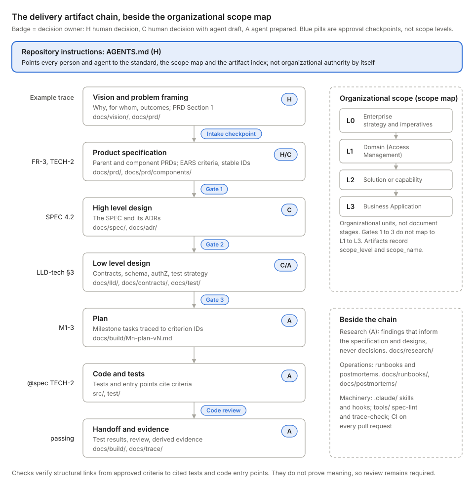
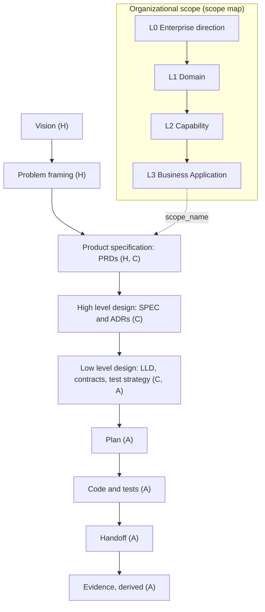
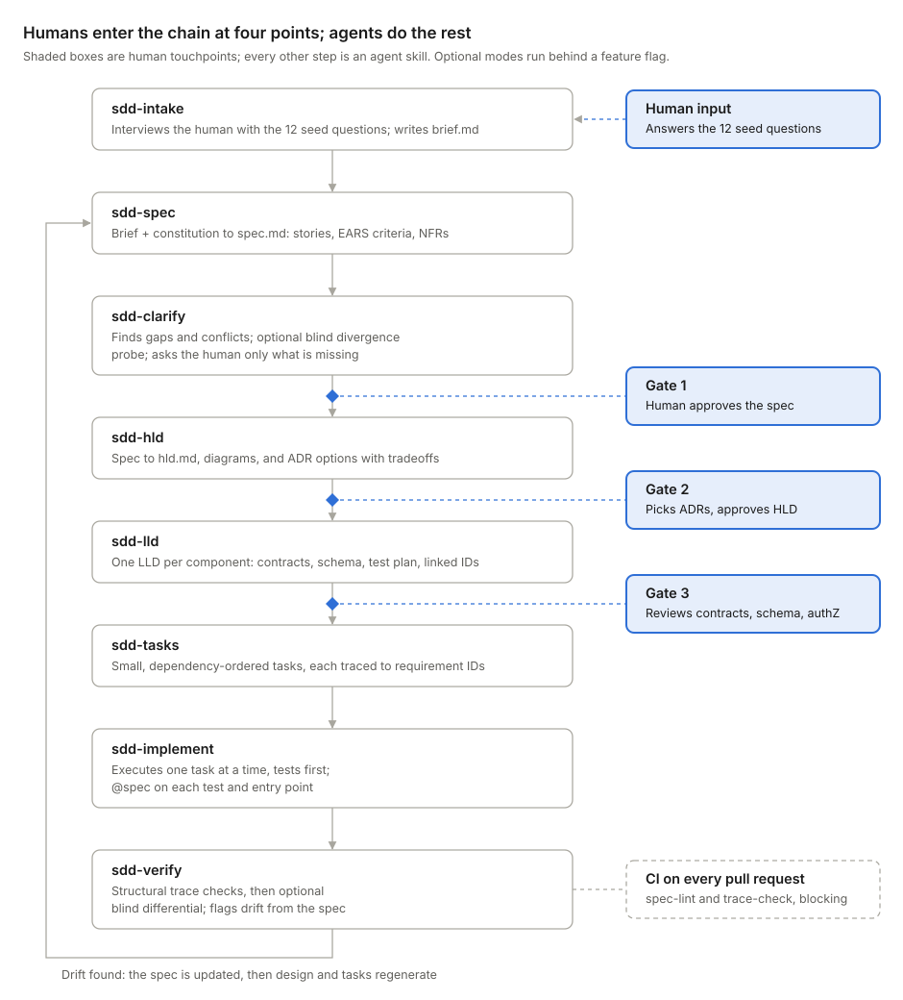

# Framework overview

Spec-driven development (SDD) is a controlled bridge from Product intent to Engineering delivery. Product owns the problem, outcomes, scope, priorities, constraints and acceptance. Engineering contributes feasibility, dependency and risk input while intent is formed, then owns architecture and implementation choices. When implementation reveals a choice that changes approved behavior, the choice goes back to Product.

Two things tend to go wrong on that bridge, and AI coding agents make both worse. Intent leaks away between the request and the code, because nothing says which decisions a person must make. And agents produce more text than people can review, so approvals turn into skims. SDD answers both: every section names its decision owner, people approve at fixed checkpoints, and scripts check that tests and code still link to what was approved. Agents prepare bounded, traceable material from approved inputs. They do not replace accountable decisions.

The rules are in the [standard](../standards/spec-driven-development-v2.md). This page explains them.

## Reusable toolkit, reference profile

The repository is a reusable toolkit. Its **portable core** is the same for everyone: templates with decision owners, human gates, stable IDs and their lifecycle, structural trace checks and change control. Each adopting organization adapts the **local choices**: approvers, ID syntax, folder layout, the intake checkpoint, whether priority and severity share one queue, and the agent tooling.

It ships with a **Tech domain reference profile**. The Tech domain is the example L1 domain where the toolkit is piloted and iterated. The worked example inside the repository is synthetic: it shows the mechanics and does not select the pilot's capability or application. This is a reference implementation, not a finished enterprise standard.

## Three separate concepts

| Concept | Values | Answers |
| --- | --- | --- |
| Organizational scope | L0 to L3 | Which part of the organization an artifact serves |
| Delivery artifact chain | Artifact types, unnumbered | Which artifact derives from which |
| Gates | Gate 1 to 3, plus the intake checkpoint | Which human approval an artifact needs |

Gates 1, 2 and 3 do not correspond to scope levels L1, L2 and L3. HLD and LLD are artifact types, not organizational levels.

**Organizational scope.** L0 is Enterprise strategy, declarations and imperatives. L1 is a domain (the Tech domain in the reference profile). L2 is a solution or capability, such as entitlement management or access certification. L3 is a Business Application. The [scope map](../scope/scope-map.yaml) records each scope, its parent and its owner, and documents carry `scope_level` and `scope_name`.

**The delivery artifact chain.**

Each artifact derives from the one above, and every requirement ID cites its parent. In the worked example, parent requirement `FR-3` becomes acceptance criterion `TECH-2` in the TECH component PRD, which the design covers in `SPEC 4.2` and `LLD-tech §3`. A milestone task builds it, and both the test and the code entry point carry `@spec TECH-2`.

## Who decides what

| Artifact | People decide | Agents prepare |
| --- | --- | --- |
| Problem framing and Product specification | Problem, outcomes, scope, invariants, NFR targets, data classification, story priority (H); requirements and acceptance criteria, selected from drafts (C) | Draft criteria as options, edge cases, open questions, glossary, ID history |
| High level design | ADR choices, trust boundaries, integrations, rollout risk, testing strategy (C) | Components, data flow, capacity, risks |
| Low level design | Public contracts, persisted schema, authorization enforcement, test strategy (C) | Modules, algorithms, errors, config, observability |
| Plans, code, evidence | Code review, acceptance of the outcome | Plans, tasks, code, tests, handoffs, derived evidence |

**H** means a person supplies and approves the content. **C** means an agent drafts options and exposes assumptions, sources and tradeoffs, and a person selects and approves. **A** means an agent prepares it from approved inputs; it cannot change approved intent and must pass the checks.

## The skill chain

People enter at four points: Product answers the seed questions and approves the problem framing at the intake checkpoint; Product approves the Product specification (Gate 1); Engineering chooses ADR options and approves the SPEC (Gate 2); the component and control owners approve contracts, schema, authorization and the test strategy in the LLD (Gate 3). In Claude Code, a hook blocks `sdd-hld`, `sdd-lld`, `sdd-tasks` and `sdd-implement` until the artifact for the component being advanced is approved.

When `sdd-verify` reports a disagreement, the named owner decides which artifact is the first one that no longer reflects approved intent. That artifact is corrected first, then the ones that depend on it. Code can be the first artifact, when it breaks an unchanged criterion.

Bugs and small changes take a short path. A change that crosses components stops for a person.

## Personas

Six human personas decide and approve: Product, Engineering, the Business Application owner, the component owner, the control owner and the exception authority. Eleven agent personas prepare and review the agent sections: `analyst`, `product-writer`, `architect`, `security-reviewer`, `component-designer`, `test-architect`, `sre`, `planner`, `implementer`, `verifier` and `doc-steward`. An agent persona never writes a human section, never approves or verifies its own work, and never edits another persona's section. A RASCI matrix maps every activity to its personas, with one accountable person per activity and agents never accountable. See the [persona standard](../standards/agent-personas-v2.md).

## Traceability and evidence

Every requirement keeps one ID for life; a change in behavior gets a new ID, and the old one is recorded as superseded. Tests and code entry points cite acceptance criteria with `@spec TECH-2`, so every hop is one text search.

The checks verify that approved criteria resolve to cited tests and behavior entry points, and they flag broken or missing structural links. They do not prove that a test checks what the criterion means, or that every line is covered, so human review remains required. Each criterion has an evidence state: `planned` (mapped in the test strategy), `test linked`, `passing` or `failing` (from a test report), `deferred`, `excepted`, `drifted` or `gap`. Tests are required once a milestone plan exists for a component; before that, a criterion only needs planned evidence.

Status lives only in derived files: `docs/trace/coverage.md` and the audit record in `docs/trace/index.yaml`, which also records the versions of the governing artifacts. Evidence goes stale when code changes, and when a governing PRD, SPEC, LLD or test strategy changes after the last audit.

Checks across the rest of the chain (L0 direction, L1 translation, design, tasks and handoff) are planned. Today the doc map shows those links, and spec-lint checks that the scope map is well formed and that `derives_from` paths exist.

## Priority and severity

Product priority (P1 to P3) ranks new capability. Operational severity (S0 to S4) ranks failures, bugs, spec gaps, blockers and drift. They are separate lenses. The reference profile tests one combined queue, S0, S1, P1, S2 and P2, S3 and P3, S4; the portable core does not require it, and an adopting organization can map both lenses into its own portfolio and incident processes.

## Limits

- The checks guard only what is annotated, and a link is not proof of meaning. Reach tracking and review narrow the gap without closing it.
- Front matter is self-asserted. Approver authority comes from `CODEOWNERS`, branch protection and the review record.
- The hooks are Claude Code adapters. Other agents follow the gates procedurally unless an equivalent adapter is installed.
- Agents built on the same model can share blind spots, which is one reason the human gates stay.
- The framework adds documents. Short artifacts, single owners and the short path keep the cost down. If a design document restates the PRD, cut it.

## Open decisions

The standard lists the decisions the toolkit does not settle: the controlled standard and its owner, the pilot's L2 capability and L3 Business Application, gate approvers and exception authority, whether the local experiments stay, and the license. See [open decisions](../standards/spec-driven-development-v2.md#18-open-decisions).
