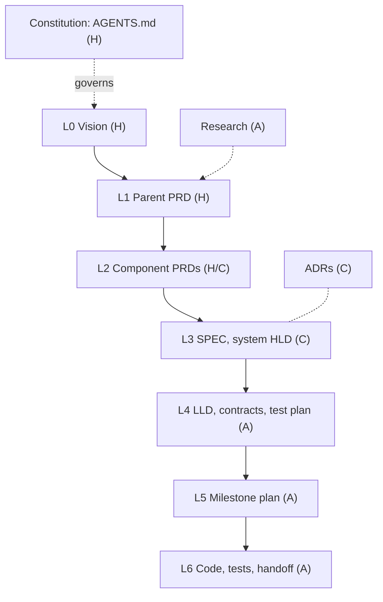

# Framework overview

AI coding agents can draft most of the documents and code in a project. Two problems follow. Agents produce more text than people can review, so approvals turn into skims. And the intent behind the work leaks away between the request and the code, because nothing says which decisions a person must make and which an agent may make.

This framework sets that rule. People write what cannot be derived from anything else: the problem, the outcomes and their targets, the scope, what must never happen, and decisions that are expensive to reverse. Agents derive everything else. People approve the results at fixed gates, and scripts check that the code still matches what was approved.

The rules themselves are in the [standard](../standards/spec-driven-development-v1.md). This page explains them.

## Six parts

1. **A document stack** of seven layers, from vision to code, under a constitution (`AGENTS.md`).
2. **Ownership tags** on every section: human-authored (H), co-authored (C) or agent-generated (A). Each agent section names the persona that writes it.
3. **Twelve seed questions.** Their answers give agents enough to draft the rest.
4. **A chain of agent skills** with four human entry points: the seed answers with the problem framing (Gate 0), then Gates 1, 2 and 3.
5. **Checked links.** Tests and code cite the criteria they satisfy with `@spec`, and CI fails when a link is broken or missing.
6. **One priority model** for delivery (P1 to P3) and support (S0 to S4), feeding one queue.

## The document stack

Each layer derives from the one above, and every requirement ID cites its parent. One requirement shows the trace: parent requirement `FR-3` becomes acceptance criterion `IAM-2` in the IAM component PRD, which the design covers in `SPEC 4.2` and `LLD-iam §3`. A milestone task builds it, and both the test and the code entry point carry `@spec IAM-2`.

## Who writes what

| Layer | Mostly | People decide or review | Agents write |
| --- | --- | --- | --- |
| PRD (L1, L2) | H | Problem, outcomes, scope, invariants, NFR targets, data classification, story priority | Acceptance criteria, edge cases, open questions, glossary |
| SPEC (L3) | C | ADR choices, trust boundaries, integrations, rollout risk | Components, data flow, capacity, risks, test strategy |
| LLD (L4) | A | Public contracts, persisted schema, authorization | Modules, algorithms, errors, config, observability, test plan |
| Plans, code (L5, L6) | A | Code review | Plans, tasks, code, tests, handoffs |

The human share falls as work moves down the stack, but it never reaches zero where a mistake is hard to reverse.

## The skill chain

People enter the chain at four points: they answer the seed questions and approve the problem framing (Gate 0, checked by `sdd-spec` but not by a hook), approve the PRD (Gate 1), choose ADR options and approve the SPEC (Gate 2), and review contracts, schema and authorization in the LLD (Gate 3). A hook blocks `sdd-hld`, `sdd-lld`, `sdd-tasks` and `sdd-implement` until their input is approved. When `sdd-verify` finds drift, the spec is fixed first and design and tasks are regenerated from it.

Bugs and small changes take a short path: spec update, tasks, code. A change that crosses components stops for a person.

## Personas

Eleven personas write the agent sections: `analyst`, `product-writer`, `architect`, `security-reviewer`, `component-designer`, `test-architect`, `sre`, `planner`, `implementer`, `verifier` and `doc-steward`. A persona never writes a human section, never approves or verifies its own work, and never edits another persona's section. See the [persona standard](../standards/agent-personas-v1.md).

## Linking and tracking

Every requirement keeps one ID for life. Tests and code entry points cite acceptance criteria with `@spec IAM-2`, so every hop is one text search. `trace-check` fails the build on annotations that cite unknown IDs, on approved criteria without tests, on coverage that `docs/trace/coverage.md` claims but the code does not show, and on deferred P1 criteria. Enforcement follows the latest approved version of each PRD. Status lives only in derived files: `docs/trace/coverage.md` and `docs/trace/index.yaml`.

The checks see only annotated code, and the agent that writes the code also places the annotations. Annotation reach is reported on every pull request so a falling number shows up in review.

## Priorities

Delivery ranks stories P1 (MVP), P2 or P3. Support ranks failures, bugs, spec gaps, blockers and drift from S0 (outage or invariant breach, immediate) to S4 (cosmetic, backlog). Both feed one queue: S0, S1, P1, S2 and P2, S3 and P3, S4.

## Limits

- The checks guard only what is annotated. Reach tracking and review narrow the gap without closing it.
- Agents built on the same model can share blind spots, which is one reason the human gates stay.
- The framework adds documents. Short artifacts, single owners and the short path keep the cost down. If a design document restates the PRD, cut it.
