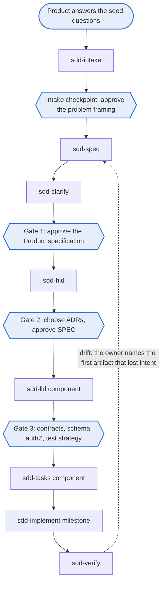

# Using the framework day to day

This guide follows one feature from idea to verified code, then covers changes, support work and the checks. The rules behind each step are in the [standard](../standards/spec-driven-development-v2.md). Product owns the steps up to Gate 1; Engineering owns the design gates and the build; agents prepare the material in between.

## The chain



| Step | Run | Writes | You do |
| --- | --- | --- | --- |
| Intake | `/sdd-new <idea>` or `/sdd-intake` | Section 1 of the parent PRD from your answers, with its scope | Answer the twelve seed questions, then approve the problem framing (intake checkpoint) |
| Spec | `/sdd-spec` | Parent and component PRDs; criteria drafted as options | Write or confirm every H section; select and approve the criteria (C) |
| Clarify | `/sdd-clarify` | Answers to open questions; optional divergence probe | Resolve every `- [ ] Q:`, then approve the Product specification (Gate 1) |
| HLD | `/sdd-hld` | SPEC, ADR options, threat model draft | Choose ADR options, approve the SPEC (Gate 2) |
| LLD | `/sdd-lld <component>` | One LLD, contracts, the test strategy with planned evidence | Approve contracts, schema, authorization and the test strategy (Gate 3) |
| Tasks | `/sdd-tasks <component>` | Milestone kickoff and plan, naming its components | Skim the plan |
| Implement | `/sdd-implement <milestone>` | Tests first, then code, both with `@spec`; handoff with test results | Review the code |
| Verify | `/sdd-verify` | Trace findings, the audit record | Name the first artifact that lost intent, for each disagreement |

## Approving a document

1. Read the document. Check every H section is yours and every C section reflects your choice.
2. Make sure no `- [ ] Q:` lines and no template placeholders remain; spec-lint fails an approved document that still has them.
3. Fill in the approvals table for the gate.
4. Set `status: approved`, `approved_by: "<name> (<role>)"` and `approved: <date>` in the front matter, and commit through a pull request that the owners in `CODEOWNERS` review.

Only people approve. The gate hook then allows the next skill for that component. The intake checkpoint (the problem framing in PRD Section 1) is also approved by a person, but no hook enforces it; `sdd-spec` checks it and stops if it is missing. The front matter records the approval; the pull request review is what proves the approver's authority. Set `approvals.requireApprover: true` in `sdd.config.json` to make spec-lint require the record.

| Checkpoint | Approver (default role) |
| --- | --- |
| Intake checkpoint | Product authority |
| Gate 1 | Product authority, with feasibility and control reviewers |
| Gate 2 | Engineering authority; Product confirms any effect on approved outcomes |
| Gate 3 | Business Application, component and control owners |

The named people for each role, the exception authority and the fast path criteria are open decisions for each adopting organization.

## Changing an approved document

Approved documents are frozen; the protect-approved hook blocks edits to them. Create the next version instead:

```bash
node tools/sdd/cli.mjs new --next docs/prd/components/PRD-tech-v1.md
```

This writes `PRD-tech-v2.md` with `status: draft` and `supersedes:` pointing at v1, and updates the doc map. Edit v2, then approve it. ADRs are never versioned: write a new ADR that supersedes the old one.

## Creating documents

Run `node tools/sdd/cli.mjs new --help` to list the document types and their options.

```bash
node tools/sdd/cli.mjs new vision
node tools/sdd/cli.mjs new prd
node tools/sdd/cli.mjs new prd-component --component tech --prefix TECH
node tools/sdd/cli.mjs new adr --name use-postgresql
node tools/sdd/cli.mjs new spec
node tools/sdd/cli.mjs new lld --component tech --prefix TECH
node tools/sdd/cli.mjs new test-plan
node tools/sdd/cli.mjs new kickoff --milestone M1
node tools/sdd/cli.mjs new plan --milestone M1
node tools/sdd/cli.mjs new handoff --milestone M1
node tools/sdd/cli.mjs new research --name token-storage
node tools/sdd/cli.mjs new runbook --name db-failover
node tools/sdd/cli.mjs new postmortem --name token-cache-outage
```

Skills call these commands for you; you rarely need them by hand.

## Linking code to requirements

Put the annotation on the test that exercises a criterion and on the entry point of the behavior:

```ts
// @spec TECH-2
export async function revokeRole(/* ... */) { /* ... */ }

// @spec TECH-2
it("invalidates cached grants within 60 seconds of revocation", async () => { /* ... */ });
```

Then regenerate the evidence report (`docs/trace/coverage.md`; the test plan itself is never edited) and run the checks:

```bash
node tools/trace-check/trace-check.mjs --write
node tools/sdd/cli.mjs check
```

To show passing and failing evidence, give trace-check a JUnit XML report from your test runner (for Vitest: `npx vitest run --reporter=junit --outputFile=reports/junit.xml`), with `--results reports/junit.xml` or `paths.testResults` in `sdd.config.json`. A test counts for a criterion when its title names the ID.

| Evidence state | Meaning | Before build | During build | At handoff |
| --- | --- | --- | --- | --- |
| `planned` | Mapped to tests in the test strategy or LLD | Enough | Error | Error |
| `test linked` | A test cites it | Fine | Enough | Run the tests |
| `passing`, `failing` | A linked test ran | | | `failing` is an error |
| `deferred`, `excepted` | The owner deferred it (P2, P3) or accepted an exception | Fine | Fine | Fine |
| `drifted` | The verifier recorded drift | Warning | Warning | Warning |
| `gap` | Nothing planned or linked | Warning | Error | Error |

"During build" starts when a milestone plan exists for the component. A link is structural evidence: review still decides whether the test checks what the criterion means.

## Bugs, small changes and support work

Run `/sdd-triage` on a bug, failure, blocker or drift finding. The triage agent assigns a type and a severity from S0 to S4, cites the affected requirement IDs and places the item in the queue. You confirm every S0 and S1.

- **S0 and S1** take the fast path: one human review covers the gates. S0 interrupts work in flight and gets a postmortem in `docs/postmortems/`.
- **S2 to S4** become normal changes, ranked with P2 and P3 stories.
- **Every fix** starts at the first artifact in the delivery trace that no longer reflects approved intent, as the owner decides: a bug against an unchanged criterion starts in code, with a reproducing test citing the criterion; a spec gap starts in the PRD or LLD.

| Support type | What it is | Triaged by |
| --- | --- | --- |
| Failure | Outage, degradation or failed deploy | `sre` |
| Bug | Behavior violates an existing criterion | `verifier` |
| Spec gap | No criterion covers the behavior, or a criterion is wrong | `verifier` |
| Blocker | Something stops delivery | `planner` |
| Drift | Two artifacts in the trace disagree | `verifier` |

Product priority and operational severity are separate lenses. This reference profile tests one combined queue: S0, S1, P1, S2 and P2, S3 and P3, S4. That is a local choice; your organization may map both lenses into its existing portfolio and incident processes instead.

## Checks

| Command | When |
| --- | --- |
| `node tools/sdd/cli.mjs check` | Before every commit |
| `node tools/trace-check/trace-check.mjs --write` | After adding or moving `@spec` annotations |
| `node tools/sdd/cli.mjs docmap` | After creating or approving a document |
| `node tools/sdd/cli.mjs catalog` | After changing a skill, persona or command |
| `node tools/sdd/cli.mjs doctor` | When something seems wrong with the setup |
| `node <path-to-new-framework>/tools/sdd/cli.mjs upgrade .` | When a new framework release is out (see [versioning](versioning.md#upgrading-a-repository-to-a-new-framework-release)) |

Switch flags such as `--apply`, `--git`, `--json`, `--force`, `--dry-run`, `--allow-dirty` and `--overwrite` never take a value, so they can go before or after the folder argument. Add `--help` to any command for its usage.

CI runs the same checks on every pull request.
