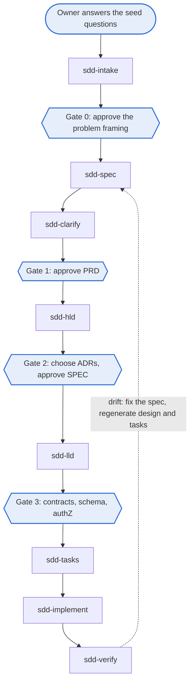

# Using the framework day to day

This guide follows one feature from idea to verified code, then covers changes, support work and the checks. The rules behind each step are in the [standard](../standards/spec-driven-development-v1.md).

## The chain



| Step | Run | Writes | You do |
| --- | --- | --- | --- |
| Intake | `/sdd-new <idea>` or `/sdd-intake` | Section 1 of the parent PRD from your answers | Answer the twelve seed questions, then approve the problem framing (Gate 0) |
| Spec | `/sdd-spec` | Parent and component PRDs | Write or confirm every H section |
| Clarify | `/sdd-clarify` | Answers to open questions; optional divergence probe | Resolve every `- [ ] Q:`, then approve (Gate 1) |
| HLD | `/sdd-hld` | SPEC, ADR options, threat model draft | Choose ADR options, approve the SPEC (Gate 2) |
| LLD | `/sdd-lld` | One LLD per component, contracts, test plan | Review contracts, schema and authorization (Gate 3) |
| Tasks | `/sdd-tasks` | Milestone kickoff and plan | Skim the plan |
| Implement | `/sdd-implement` | Tests first, then code, both with `@spec`; handoff | Review the code |
| Verify | `/sdd-verify` | Trace findings, audit index updates | Decide where drift is fixed |

## Approving a document

1. Read the document. Check every H section is yours and every C section reflects your choice.
2. Make sure no `- [ ] Q:` lines and no template placeholders remain; spec-lint fails an approved document that still has them.
3. Fill in the approvals table for the gate.
4. Set `status: approved` in the front matter and commit.

Only people approve. The gate hook then allows the next skill. Gate 0 (the problem framing in PRD Section 1) is also approved by a person, but no hook enforces it; `sdd-spec` checks it and stops if it is missing.

## Changing an approved document

Approved documents are frozen; the protect-approved hook blocks edits to them. Create the next version instead:

```bash
node tools/sdd/cli.mjs new --next docs/prd/components/PRD-iam-v1.md
```

This writes `PRD-iam-v2.md` with `status: draft` and `supersedes:` pointing at v1, and updates the doc map. Edit v2, then approve it. ADRs are never versioned: write a new ADR that supersedes the old one.

## Creating documents

Run `node tools/sdd/cli.mjs new --help` to list the document types and their options.

```bash
node tools/sdd/cli.mjs new vision
node tools/sdd/cli.mjs new prd
node tools/sdd/cli.mjs new prd-component --component iam --prefix IAM
node tools/sdd/cli.mjs new adr --name use-postgresql
node tools/sdd/cli.mjs new spec
node tools/sdd/cli.mjs new lld --component iam --prefix IAM
node tools/sdd/cli.mjs new test-plan
node tools/sdd/cli.mjs new kickoff --milestone M1
node tools/sdd/cli.mjs new plan --milestone M1
node tools/sdd/cli.mjs new handoff --milestone M1
node tools/sdd/cli.mjs new research --name token-storage
node tools/sdd/cli.mjs new runbook --name db-failover
node tools/sdd/cli.mjs new postmortem --name token-cache-outage
```

Skills call these commands for you; you rarely need them by hand.

## Linking code to requirements

Put the annotation on the test that exercises a criterion and on the entry point of the behavior:

```ts
// @spec IAM-2
export async function revokeRole(/* ... */) { /* ... */ }

// @spec IAM-2
it("invalidates cached grants within 60 seconds of revocation", async () => { /* ... */ });
```

Then regenerate the coverage report (`docs/trace/coverage.md`; the test plan itself is never edited) and run the checks:

```bash
node tools/trace-check/trace-check.mjs --write
node tools/sdd/cli.mjs check
```

## Bugs, small changes and support work

Run `/sdd-triage` on a bug, failure, blocker or drift finding. The triage agent assigns a type and a severity from S0 to S4, cites the affected requirement IDs and places the item in the queue. You confirm every S0 and S1.

- **S0 and S1** take the fast path: one human review covers the gates. S0 interrupts work in flight and gets a postmortem in `docs/postmortems/`.
- **S2 to S4** become normal changes, ranked with P2 and P3 stories.
- **Every fix** starts at the layer where behavior left intent: a bug starts with a reproducing test citing the criterion; a spec gap starts in the PRD or LLD.

The one queue: S0, S1, P1, S2 and P2, S3 and P3, S4.

## Checks

| Command | When |
| --- | --- |
| `node tools/sdd/cli.mjs check` | Before every commit |
| `node tools/trace-check/trace-check.mjs --write` | After adding or moving `@spec` annotations |
| `node tools/sdd/cli.mjs docmap` | After creating or approving a document |
| `node tools/sdd/cli.mjs catalog` | After changing a skill, persona or command |
| `node tools/sdd/cli.mjs doctor` | When something seems wrong with the setup |
| `node <path-to-new-framework>/tools/sdd/cli.mjs upgrade .` | When a new framework release is out (see [versioning](versioning.md#upgrading-a-repository-to-a-new-framework-release)) |

Switch flags such as `--apply`, `--git`, `--json`, `--force`, `--dry-run`, `--allow-dirty` and `--overwrite` never take a value, so they can go before or after the folder argument. Add `--help` to any command for its usage.

CI runs the same checks on every pull request.
