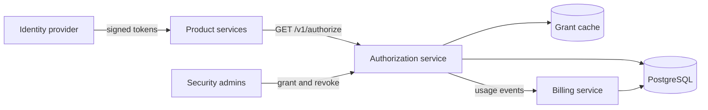
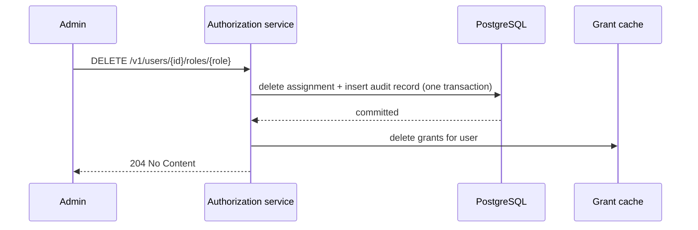

# SPEC: access platform system design (v1)

> The system-wide technical spec, which plays the HLD role. Each component has its own LLD. Parent: [PRD-v1](../prd/PRD-v1.md). Decisions: [ADR 0001](../adr/0001-use-postgresql.md), [ADR 0002](../adr/0002-jwt-token-revocation.md).

## 1. System context

> **Owner:** C · **Persona:** `architect`

Product services call the authorization service to check access. Security administrators grant and revoke roles through an admin API. The identity provider issues signed tokens that identify callers. Finance reads monthly invoices from the billing service.

## 2. Architecture principles

> **Owner:** H. Standing principles live in the constitution; these are specific to this system.

- Decide and record; do not store user profiles.
- Correctness of revocation beats raw speed: a stale grant is worse than a slow check.

## 3. Components

> **Owner:** A · **Persona:** `architect`

| Component | Responsibility | LLD |
| --- | --- | --- |
| IAM (authorization service) | Access checks, grants, revocation, audit log | [LLD-iam-v1](../lld/LLD-iam-v1.md) |
| Billing | Usage metering and monthly invoices | [LLD-billing-v1](../lld/LLD-billing-v1.md) (draft) |

## 4. Data flow

> **Owner:** A · **Persona:** `architect`

### 4.1 Access check

The caller sends a token and an action. The service validates the token, reads the user's grants from the grant cache (falling back to PostgreSQL on a miss), and answers allow or deny. A usage event is emitted for billing.

### 4.2 Role revocation

An administrator revokes a role. In one database transaction the service deletes the role assignment and appends an audit record. After the commit it deletes the user's grant-cache entry, so the next access check reads current grants. Cache entries also expire after 30 seconds, which bounds the effect of a lost invalidation (ADR 0002). Covers FR-2, FR-3, IAM-2, IAM-3 and IAM-4. Detail: [LLD-iam §3](../lld/LLD-iam-v1.md).

### 4.3 Usage metering

Each access check emits a usage event with the calling team. The billing service aggregates events per team and day.

## 5. Data model

> **Owner:** A · **Persona:** `architect`

| Entity | Key fields | Store |
| --- | --- | --- |
| Role | name, actions | PostgreSQL |
| Role assignment | user_id, role, granted_at | PostgreSQL |
| Audit record | id, actor, user_id, role, action, at | PostgreSQL, append only |
| Grant cache entry | user_id, actions, expires_at | Grant cache |
| Usage count | team, day, checks | PostgreSQL |

## 6. Trust boundaries and authorization

> **Owner:** C · **Persona:** `security-reviewer`; the owner decided

- Every request carries a token signed by the identity provider; unsigned or expired tokens are rejected (INV-3).
- Only callers with the `access-admin` role may grant or revoke roles.
- The audit table accepts inserts only; the service's database user has no update or delete rights on it (INV-2).

## 7. Capacity

> **Owner:** A · **Persona:** `architect`

Peak load is 2,000 access checks per second. With a 95% cache hit rate, PostgreSQL serves about 100 reads per second, well within one primary and one replica. Revocations are rare (under 100 per day).

## 8. Risks

> **Owner:** A · **Persona:** `architect`; the owner ranked them at Gate 2

| Risk | Likelihood | Impact | Mitigation |
| --- | --- | --- | --- |
| Lost cache invalidation leaves a stale grant | Low | High | 30-second time-to-live; invalidation failure alert |
| Cache outage slows checks | Medium | Medium | Fall back to the database; S2 alert |
| Audit table grows large | High | Low | Monthly partitions |

## 9. Rollout and migration

> **Owner:** C · **Persona:** `sre`; the owner set the risk tolerance (PRD 2.9)

Pilot with three teams behind a per-team feature flag, then 25% of teams, then all. Halt on any S0 or on access check errors above 0.1% for 10 minutes.

## 10. Testing strategy

> **Owner:** A · **Persona:** `test-architect`

Unit tests cover each acceptance criterion and cite it with `@spec`. An integration test runs revocation against a real database and cache. A load test checks NFR-1 before each release. Per-criterion coverage lives in the [test plan](../test/test-plan-v1.md).

## 11. Traceability: PRD to SPEC

> **Owner:** A · **Persona:** `architect`

| Requirement | SPEC section | LLD |
| --- | --- | --- |
| FR-1 | 4.1 | LLD-iam §2 |
| FR-2 | 4.2 | LLD-iam §3 |
| FR-3 | 4.2, 5 | LLD-iam §4 |
| FR-4 | 4.3 | LLD-billing (draft) |
| FR-5 | 4.3 | LLD-billing (draft) |
| NFR-1 | 7 | LLD-iam §6 |
| INV-2 | 6 | LLD-iam §4 |
